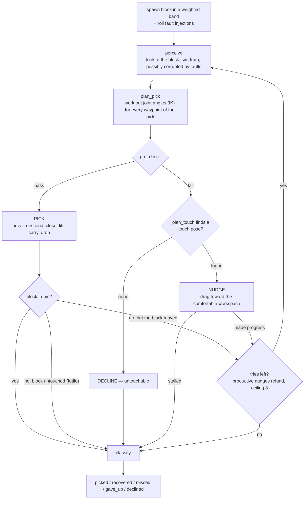
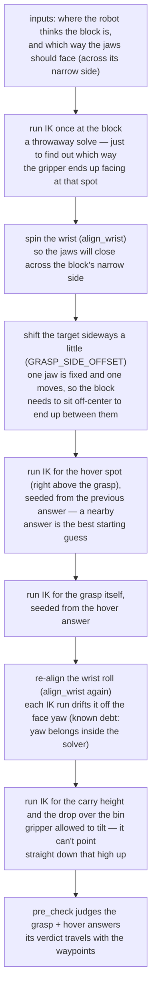
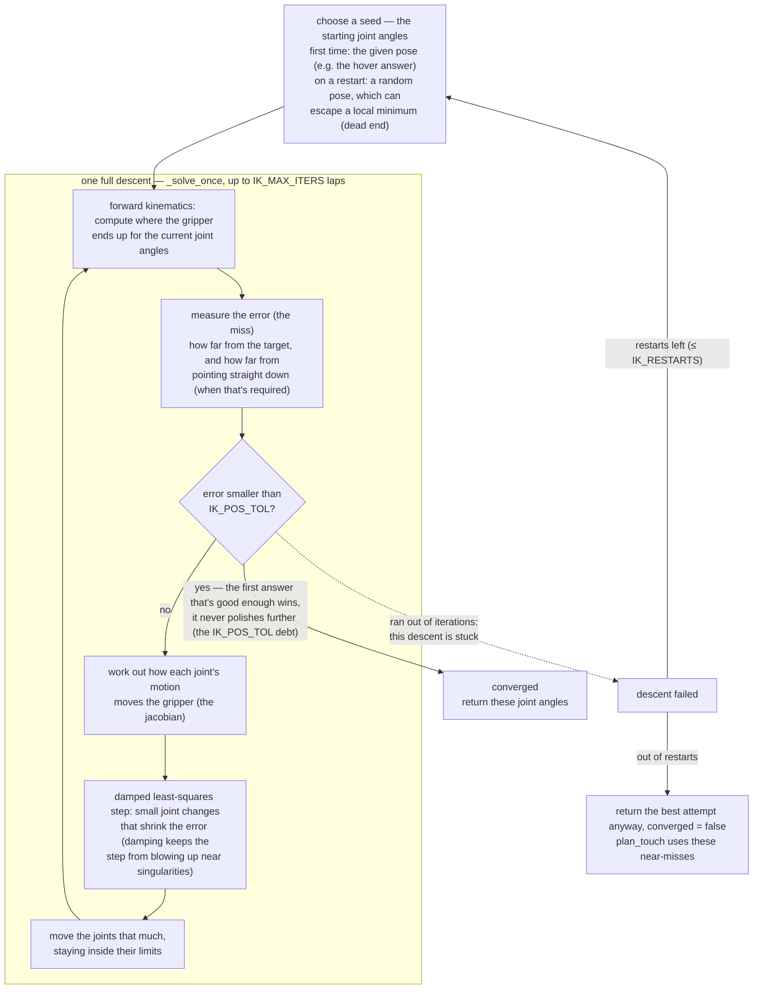
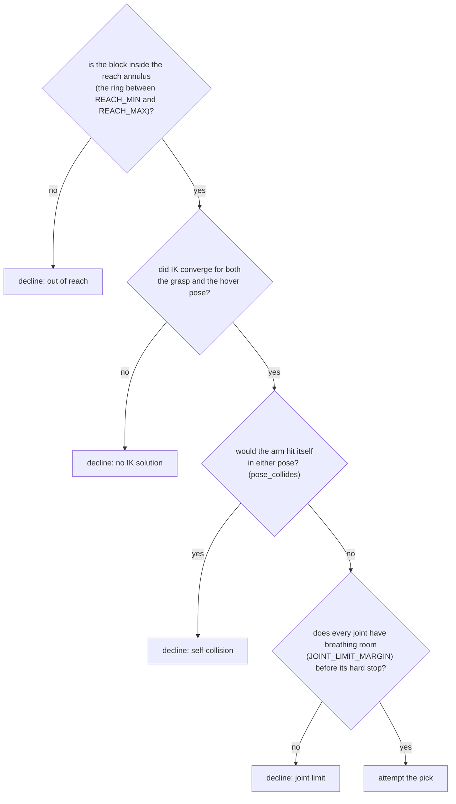
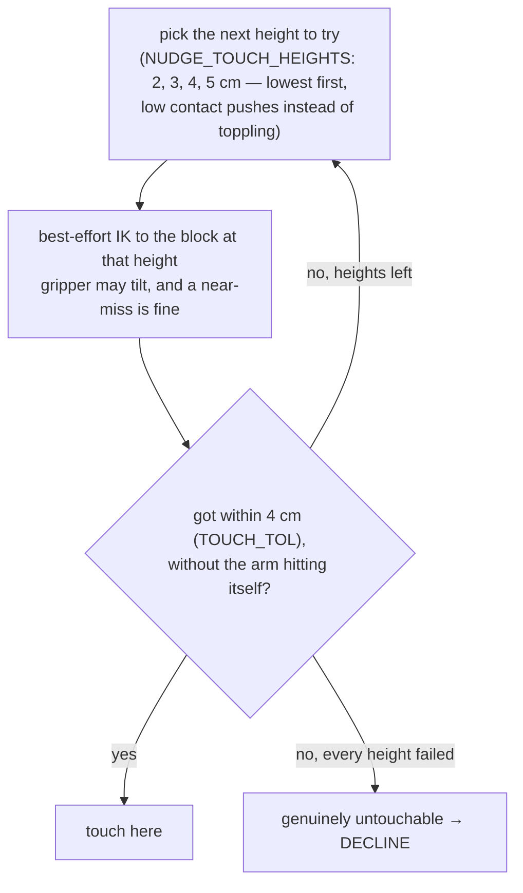
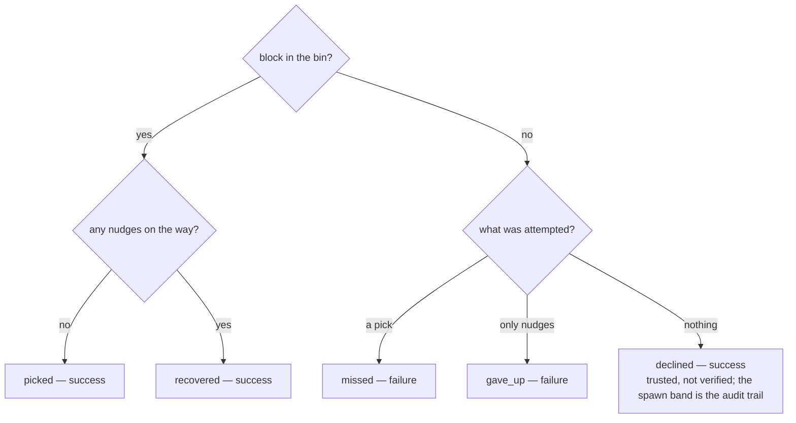

# Architecture

How the pieces fit. Five source files, one scene, one log folder.

## Files

```
pick_scene.xml   the world: SO-101 arm, block (4x4x6cm), bin, overhead camera
config.py        every tunable number; code reads it, you edit it
ik.py            inverse kinematics: solve / align_wrist / site_frame
checks.py        judgment calls: pre_check, success_check, pose_collides
pick_place.py    everything else: Sim wrapper, strategy, episode loop, main
tests/           pure-function tests + kinematic regression tests
logs/            one JSON per run: every try of every episode + config snapshot
docs/            this folder
```

Dependency direction is one-way: `pick_place → checks → ik → config`. Nothing
imports upward, and only `pick_place.py` touches the live simulation.

## One run

```
main()
  parse args (seed, attempts, --feasible, --replay...)
  for each episode:
    episode(sim, rng)        one block, start to finish
  write logs/run_<stamp>.json
```

## One episode (the core loop, in pick_place.episode)



Two self-honesty rules guard the loop: a failed **pick** earns a retry only if
it moved the block (`pick_is_futile`), and a second **nudge** must be earned by
the first one shrinking the gap (`earned_budget` / `nudge_gap`).

The sections below zoom into each box of that loop.
(Perceive gets its own diagram once the sim camera replaces ground truth —
today it's one line of arithmetic; see "Perception and faults".)

## Zoom: planning a pick (pick_place.plan_pick)

Planning is all IK — six solves and three wrist alignments before the arm
ever moves:



**A fragility to remember (the screwdriver condition).** The wrist-alignment
steps only work while the gripper points straight down: wrist_roll then spins
the jaws about the vertical axis like twisting a vertical screwdriver — the
tip stays put, so the solved position survives the twist. Tilt the gripper
and that stops being true: twisting would swing the gripper through space,
entangling orientation with position. Two steps of this diagram depend on
that coincidence (`align_wrist` and the re-align pass), and both break the
day we allow tilted grasps — e.g. for tall objects, which hover height
already forces toward tilting. The cure for both, plus the throwaway solve,
is in IDEAS.md → Architectural debt (yaw inside the solver; grasp-center
offset into the model).

## Zoom: one IK solve (ik.solve)

Two layers in one picture. The box in the middle is the engine — one complete
descent (`_solve_once`), the inner loop. Everything outside it is the outer
layer (`solve`), whose only job is choosing starting points (seeds) and
re-running the engine when a descent gets stuck:



Note what carries between laps: only the joint angles, getting progressively
better. Forward kinematics is not an output — it's the measuring instrument,
recomputed fresh every lap ("where *would* the gripper be with my current
angles?"), because you can't know how far off you are without computing where
you are.

## Zoom: the pre-check gauntlet (checks.pre_check)

Four conditions, cheapest first; the first failure is the decline reason
logged for the episode:



`pose_collides` answers one question IK cannot: a converged solution can
still thread the gripper through the robot's own body. It poses the arm on a
scratch copy of the world, parks the block far away, and reports any contact
that isn't the floor.

## Zoom: executing a pick (the motion itself)

```
open jaws
rise to CARRY_Z      travel high — low arcs were clipping blocks en route
over the target      still high
HOVER_Z              directly above the grasp point
descend to grasp     vertical, so the approach can't plow the block
close jaws
lift to HOVER_Z      straight up before leaving
carry to the bin     high again
DROP_Z, open jaws
settle, HOME
```

Every leg is joint-space interpolation, so the Cartesian path between
waypoints is nobody's choice — the travel-high pattern exists to keep those
unplanned arcs away from the block (failure-mode class 3).

## Zoom: a nudge (plan_touch + the drag)

Finding a touch pose — a ladder of heights, lowest first because low contact
pushes rather than topples:



The drag target (`nudge_target`): aim the block at radius `NUDGE_TARGET_R`
along its own bearing, angle clamped to `NUDGE_ANGLE_CLAMP`, moving at most
`NUDGE_DRAG_MAX` per nudge. Then the motion:

```
close jaws → rise high (CARRY_Z) → above the block (HOVER_Z) →
down to the touch height → drag to the target → lift → HOME
```

Approach from above and lift before leaving — both exist because the
straight-line versions moved the block by accident.

## Zoom: scoring an episode (pick_place.classify)



## Perception and faults

The robot never reads the block's position directly during planning — it reads
`perceive(truth, injections)`. With no faults drawn, that's exact ground truth;
with faults, it's deliberately corrupted (stale-camera bias, per-reading noise).
Physics-side faults (block teleport, low friction) change the world instead.
This is the seam where the sim camera will plug in later: replace ground truth
with a pose estimate, keep everything downstream unchanged.

## Determinism

One seed reproduces a whole run: the main RNG drives spawns, and each episode
gets a child RNG for its internal draws — so `--replay` can skip episodes at
fixed cost and land replayed ones to the millimeter.

## Testing strategy

Pure logic (sampling, classification, gap math, budgets) is unit-tested in
`tests/`. Sim behavior is verified two other ways: throwaway probes that measure
one thing (per-phase block motion, jaw depth, workspace sweeps), and seeded
benchmark runs before/after every change.
